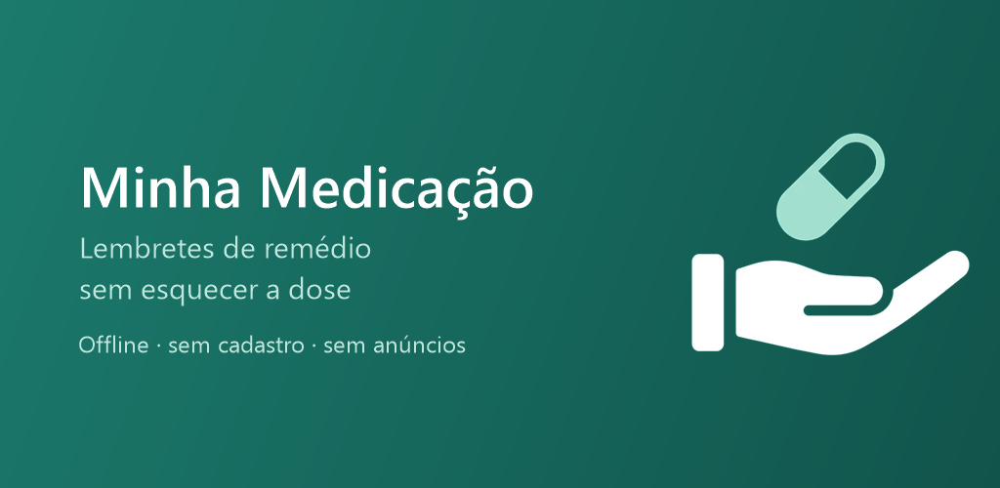
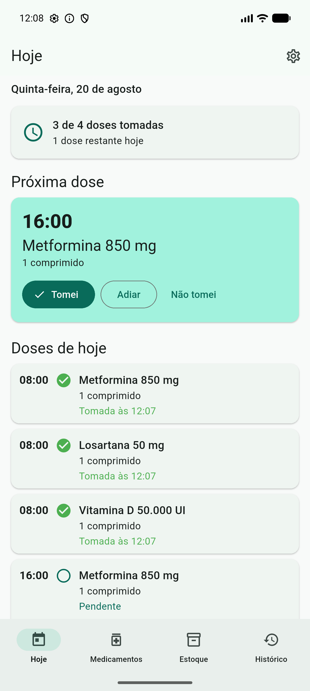
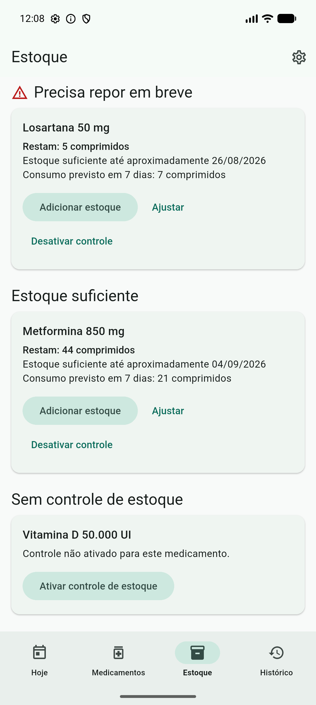
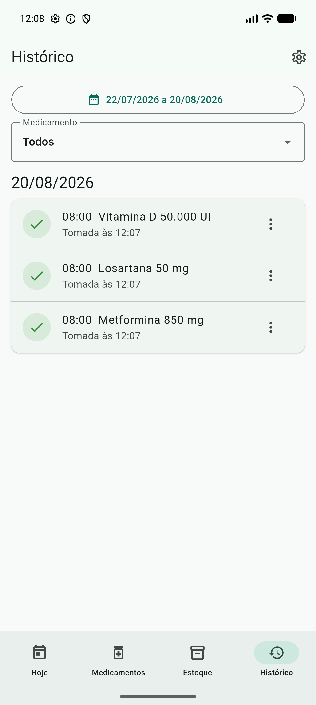
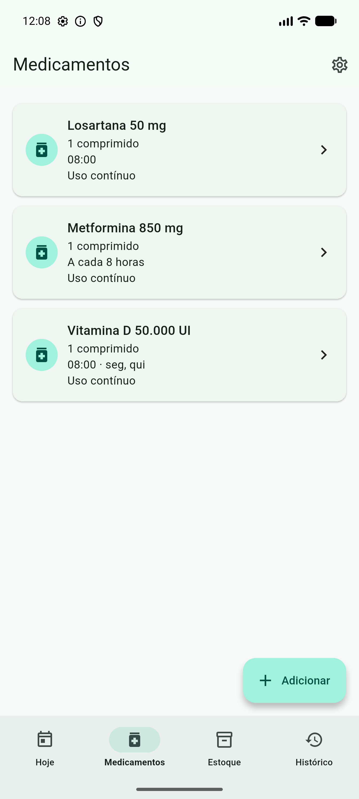
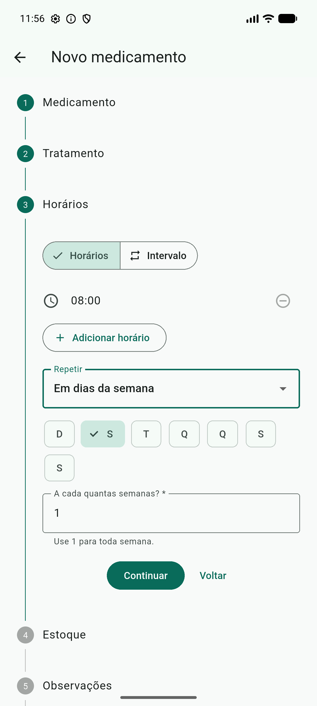
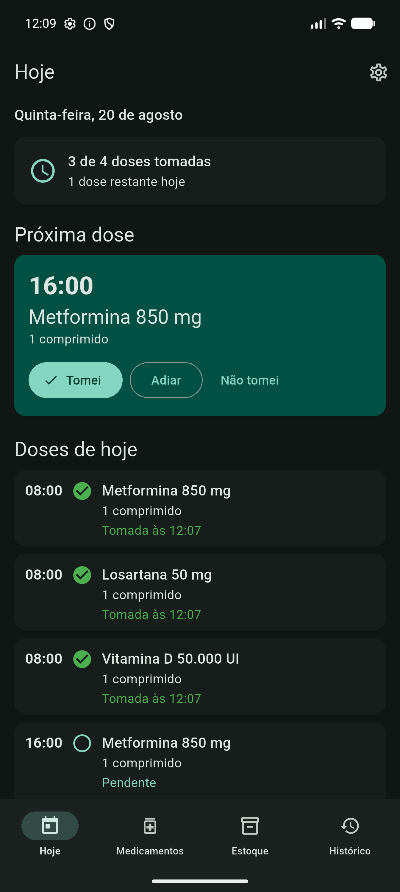
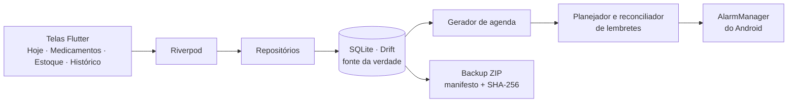

<div align="center">



[](https://github.com/DEV-Peterson/minha_medicacao/releases/latest)


[](LICENSE)

**[Baixar o aplicativo](https://github.com/DEV-Peterson/minha_medicacao/releases/latest)** ·
[Como instalar](#como-instalar) ·
[Privacidade](docs/politica-de-privacidade.md) ·
[Para quem programa](#para-quem-programa)

</div>

---

## Por que este aplicativo existe

Minha mãe precisa tomar várias vitaminas todos os dias. Com tantos frascos,
horários e quantidades, é fácil perder a conta: *"será que eu já tomei essa
hoje?"*. O Minha Medicação nasceu para ajudá-la: ele mostra o que tomar, avisa
na hora certa e guarda o registro de cada dose.

Depois decidi deixar o aplicativo disponível para qualquer pessoa com a mesma
rotina — quem toma vários remédios ou cuida de alguém que toma. É um projeto
pessoal, **gratuito e sem fins lucrativos**. Por isso não tem conta, não tem
anúncio, não tem cobrança e **não usa internet**: tudo o que você cadastra fica
só no seu celular.

## O que ele faz

- **Agenda do dia** — o que tomar, a que horas e quanto.
- **Lembretes no horário**, mesmo com a tela bloqueada, com **Tomei**,
  **Adiar** e **Não tomei** direto no aviso.
- **Registro de cada dose**, para não repetir um remédio por esquecimento.
- **Controle de estoque** — quantos comprimidos restam, previsão de quando
  acabam e aviso antes de faltar.
- **Histórico** das doses tomadas e não tomadas.
- **Qualquer rotina de tratamento**: uso contínuo ou com data para acabar;
  horários fixos (08:00 e 20:00) ou intervalos (a cada 8 horas); todos os dias,
  dias alternados, dias da semana escolhidos ou uma vez por mês.
- **Foto do medicamento e da receita**, para não confundir caixas parecidas.
- **Cópia de segurança** em arquivo, para trocar de celular sem perder nada.
- **Tema claro e escuro**, acompanhando o celular.

## Telas

<table>
  <tr>
    <td align="center"><br><sub>Agenda do dia</sub></td>
    <td align="center"><br><sub>Estoque e previsão</sub></td>
    <td align="center"><br><sub>Histórico</sub></td>
  </tr>
  <tr>
    <td align="center"><br><sub>Medicamentos</sub></td>
    <td align="center"><br><sub>Repetição semanal</sub></td>
    <td align="center"><br><sub>Tema escuro</sub></td>
  </tr>
</table>

## Seus dados ficam com você

- Não existe conta, login nem servidor.
- O aplicativo não tem permissão de acesso à internet.
- Nada é coletado, rastreado ou compartilhado — nem com quem desenvolveu.
- O backup automático do Android fica desligado de propósito; a cópia de
  segurança só sai do celular quando **você** decide compartilhá-la.

Detalhes na [Política de Privacidade](docs/politica-de-privacidade.md).

## Como instalar

Funciona em celulares com **Android 7 ou mais novo**. Não funciona em iPhone.

1. Pelo celular, abra a **[página de downloads](https://github.com/DEV-Peterson/minha_medicacao/releases/latest)**
   e toque em `Minha-Medicacao.apk`.
2. Abra o arquivo baixado. O Android vai perguntar se você autoriza instalar
   aplicativos dessa origem — pode permitir: o aviso aparece porque o
   aplicativo não veio da Play Store.
3. Confirme a instalação e abra o aplicativo.
4. Na primeira abertura, **permita as notificações e os alarmes**. É assim que
   os lembretes chegam no horário.

**Para atualizar**, baixe a versão nova e instale por cima, sem desinstalar.
Seus dados são preservados. Desinstalar apaga tudo, então faça uma cópia de
segurança antes se precisar.

## Perguntas comuns

<details>
<summary><b>Por que não está na Play Store?</b></summary>

O Google Play exige que aplicativos de controle de medicamentos sejam
publicados por empresas (conta de organização). Como este é um projeto
pessoal e sem fins lucrativos, a distribuição é feita aqui, pelo GitHub, com o
mesmo aplicativo e a mesma assinatura digital de sempre.
</details>

<details>
<summary><b>Não recebi o lembrete no horário. E agora?</b></summary>

Quase sempre é a economia de bateria do Android segurando o aviso. Vá em
*Configurações do celular → Aplicativos → Minha Medicação → Bateria* e escolha
**sem restrição**. Dentro do aplicativo, *Configurações → Lembretes* mostra se
notificações e alarmes estão liberados.
</details>

<details>
<summary><b>Vou trocar de celular. Perco tudo?</b></summary>

Não, se fizer uma cópia antes. Em *Configurações → Backup → Criar backup*, o
aplicativo gera um arquivo que você pode salvar no Google Drive ou mandar para
si mesmo. No celular novo, instale o aplicativo e use *Restaurar backup*.
</details>

<details>
<summary><b>Preciso de internet?</b></summary>

Não. Ele funciona normalmente no modo avião.
</details>

<details>
<summary><b>Posso usar para mais de uma pessoa?</b></summary>

Ele foi pensado para uma pessoa por celular. Dá para cadastrar quantos
medicamentos quiser, mas não há separação por perfil.
</details>

## Importante

O Minha Medicação **organiza, não orienta**. Ele não é um dispositivo médico:
não diagnostica, não trata, não indica medicamentos, não calcula doses e não
diz o que fazer quando uma dose é esquecida. Ele lembra e registra o que você
cadastrou, seguindo a prescrição do seu médico.

Em caso de dúvida sobre um remédio ou uma dose perdida, fale com o profissional
de saúde que acompanha o tratamento. Veja também os
[Termos de Uso](docs/termos-de-uso.md).

---

## Para quem programa

Aplicativo Android em **Flutter**, com banco **SQLite** local e arquitetura em
camadas. Algumas decisões que valem a leitura:

- **O banco é a fonte da verdade.** A agenda da tela e os lembretes agendados
  são projeções reconstruídas a partir do SQLite — nunca o contrário.
- **Confirmar uma dose é idempotente.** Tocar em *Tomei* no aviso e no app ao
  mesmo tempo registra uma única dose e baixa o estoque uma única vez.
- **Estoque é um livro-razão.** Reposições e consumos são lançamentos; corrigir
  uma dose gera um estorno vinculado, sem apagar nada.
- **Agenda por data civil.** Intervalos e repetições são contados em dias do
  calendário, então não "andam" com mudança de fuso ou horário de verão.
- **Lembretes reconciliados.** Cada lembrete tem um identificador estável; o app
  compara o que deveria estar agendado com o que está e corrige a diferença.
- **Backup verificável.** O arquivo ZIP leva um manifesto com SHA-256; a
  restauração valida tudo e cria uma cópia de segurança antes de substituir os
  dados.
- **Migrações testadas** a cada versão do banco, sem nunca recriar os dados da
  pessoa.
- **Mais de 150 testes automatizados**, incluindo layouts de 320 px a tablet
  com fonte ampliada em 160%.



| Camada | Tecnologia |
| --- | --- |
| Interface | Flutter 3.44 · Dart 3.12 · Material 3 |
| Estado e injeção | Riverpod |
| Dados | Drift sobre SQLite, com chaves estrangeiras, constraints e migrations |
| Lembretes | flutter_local_notifications · timezone |
| Backup | archive · crypto · share_plus · file_picker |

```text
lib/
├── app/        composição, providers, tema e layout responsivo
├── core/       banco, lembretes, backup, arquivos e data/hora
└── features/   hoje, medicamentos, estoque, histórico e configurações
```

Para rodar localmente:

```bash
flutter pub get
dart run build_runner build --delete-conflicting-outputs
flutter test
flutter run
```

Arquitetura, migrations, assinatura e geração do APK estão em
[DESENVOLVIMENTO.md](DESENVOLVIMENTO.md).

## Licença

Código sob a [licença MIT](LICENSE). Use, estude e adapte à vontade.

## Autor

Feito por **Peterson Rocha** — [@DEV-Peterson](https://github.com/DEV-Peterson).
Sugestões e problemas: abra uma [issue](https://github.com/DEV-Peterson/minha_medicacao/issues)
ou escreva para petersonmarinho07@hotmail.com.
